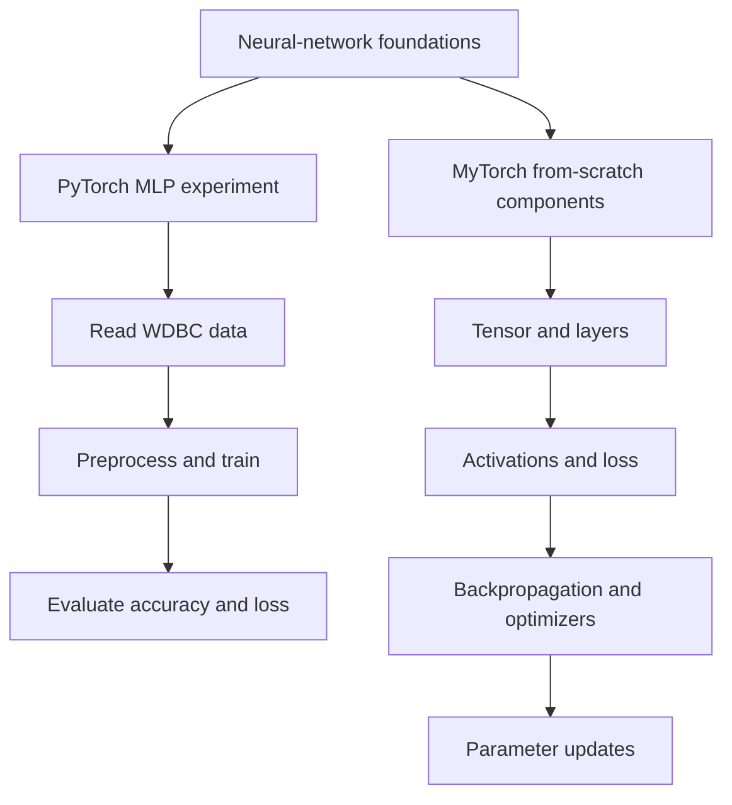

# MyTorch Framework & PyTorch MLP Classifier

**Deep-learning foundations, implemented and explored in Python.**

This repository contains two complementary experiments: (1) an MLP classifier for the Wisconsin Diagnostic Breast Cancer dataset using **PyTorch**, and (2) a small **NumPy-based neural-network library** implementing core learning components.

## Project map



| Part | Files | Purpose |
| --- | --- | --- |
| PyTorch experiment | [`task1.ipynb`](./task1.ipynb) | Dataset preprocessing, model training, and evaluation |
| MyTorch experiment | [`task2.ipynb`](./task2.ipynb) | Work with the custom neural-network components |
| Framework code | [`mytorch/`](./mytorch/) | Tensor, layers, activations, losses, optimizers, and utility modules |
| Dataset | [`wdbc.data`](./wdbc.data) | Wisconsin Diagnostic Breast Cancer dataset used by the notebooks |

## Example result


*An actual saved notebook output showing training/testing accuracy on WDBC. This is a historical project artifact, not a new training run.*

The previous project README reported **96%+ training accuracy** and **85%+ test accuracy** for the PyTorch MLP; reproduce those numbers in the provided notebooks before comparing against other methods.

## Inside MyTorch

```text
mytorch/
  tensor.py          Tensor operations and gradient support
  model.py           Model abstraction
  layer/             Linear and other layer components
  activation/        ReLU, Sigmoid, Softmax, etc.
  loss/              MSE and cross-entropy implementations
  optimizer/         SGD and additional optimizers
  util/              Initializers, data loading, utilities
```

The core idea is to expose what a high-level training framework ordinarily hides: tensor operations, forward computation, loss calculation, gradient propagation, and parameter updates.

## Getting started

```bash
git clone https://github.com/Parand1khalili/MLP-Classifier-MyTorch-Framework.git
cd MLP-Classifier-MyTorch-Framework
jupyter notebook
```

Open `task1.ipynb` or `task2.ipynb` in Jupyter. The notebooks use Python scientific and ML libraries (including NumPy and PyTorch); install the imports needed by each notebook in your chosen environment.

**Reproducibility note:** there is no pinned dependency/lock file or standalone test runner in the present repository. The Python cache files present in the historical source tree are generated artifacts, not required source code.

## What this demonstrates

- Implementing learning primitives instead of relying solely on a framework API.
- Understanding the interaction between tensors, activation functions, losses, gradients, and optimizers.
- Comparing experiment outputs in an applied binary-classification task.
